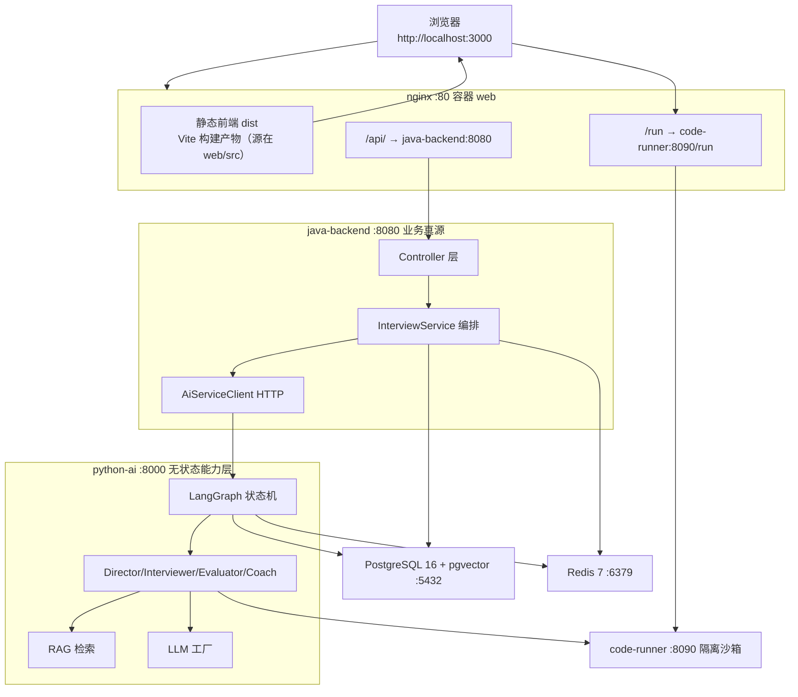
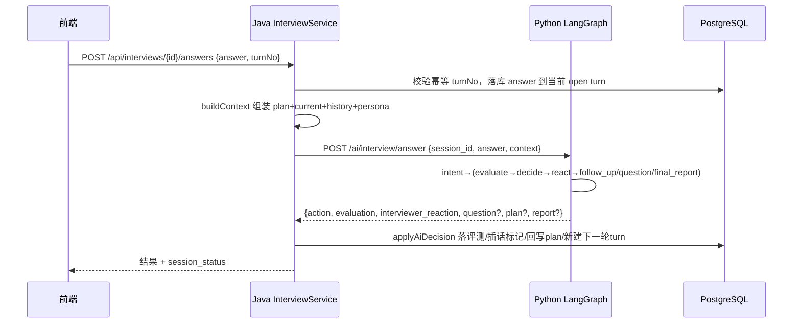
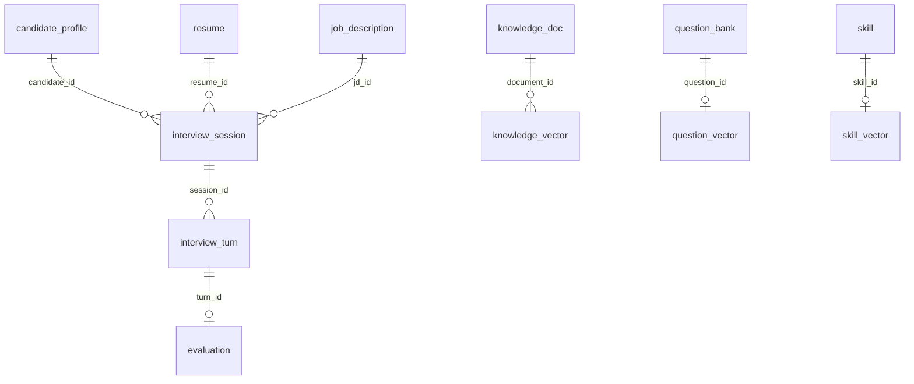
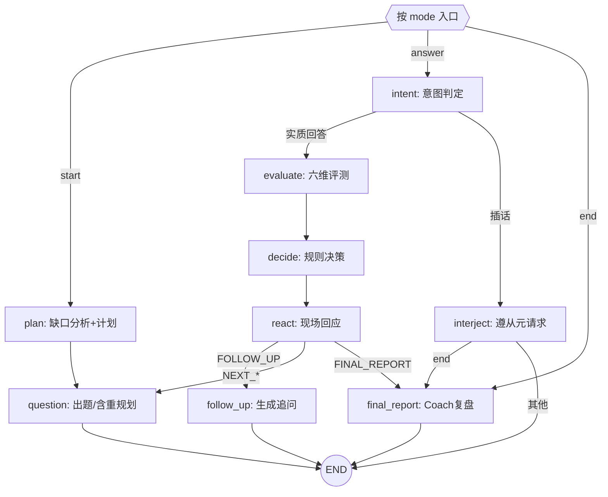
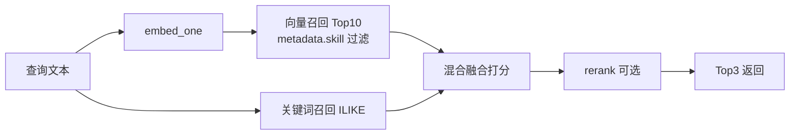

# 智能自适应 AI 面试系统 · 详细架构文档

> **文档说明**：本文基于仓库当前真实代码逐项核实后编写，覆盖各功能的实现细节、关键常量、接口契约与数据流。它是现行实现的权威描述，**取代**根目录《智能自适应AI面试系统设计文档.md》中关于"系统现状"的部分；后者作为项目初期的设计蓝图与需求来源继续保留（文中各模块源码注释里的"设计文档 §x"即指向该蓝图）。

---

## 目录

1. [概述与产品定位](#1-概述与产品定位)
2. [技术栈与选型理由](#2-技术栈与选型理由)
3. [核心架构原则](#3-核心架构原则)
4. [数据模型](#4-数据模型)
5. [Java 后端实现细节](#5-java-后端实现细节)
6. [Python AI 层实现细节](#6-python-ai-层实现细节)
7. [意图识别与插话处理](#7-意图识别与插话处理)
8. [RAG 与知识库](#8-rag-与知识库)
9. [代码题与执行沙箱](#9-代码题与执行沙箱)
10. [前端实现（Vue 3 工程）](#10-前端实现vue-3-工程)
11. [API 契约参考](#11-api-契约参考)
12. [部署与运维](#12-部署与运维)
13. [已知限制与演进方向](#13-已知限制与演进方向)

---

## 1. 概述与产品定位

本系统是一个**训练导向的智能自适应 AI 面试平台**：上传简历与岗位 JD 后，多 Agent 编排引擎生成个性化面试计划并逐题考察，实时对回答做六维度评分、依据表现自适应调整难度与追问，面试结束生成含 JD 逐项匹配、7 天训练计划的复盘报告，并把薄弱点写入候选人长期画像形成数据闭环。

核心能力清单：

- **自适应流程**：缺口分析 → 面试计划 → 出题 → 评测 → 规则决策（追问 / 换题 / 升难 / 降难 / 收尾）→ 现场回应，每 3 题触发一次有界重规划。
- **可解释评测**：六维度加权评分、参考要点命中清单聚合、证据化 issues（逐字摘录候选人原话）、防背书检测、边界双评委仲裁、跨轮漂移钳制。
- **面试官人格**：5 种风格（standard / friendly / pressure / socratic / english）贯穿出题、追问、回应、提示全链路。
- **对话智能**：识别"换题 / 跳过 / 要提示 / 澄清题意 / 结束 / 闲聊"等元请求并遵从，插话轮不评分、不计入主题进度。
- **代码题**：沙箱在线运行 java / python / javascript，以真实运行结果作为评测证据。
- **分级提示**：三级（方向 / 关键点 / 揭晓），提示次数计入评测降档。
- **多模态与闭环**：语音回答 ASR 转写、弱项回写长期画像、跨会话成长曲线。

### 1.1 四层架构总览



六个容器（compose service → container_name）：`postgres`(interview-postgres)、`redis`(interview-redis)、`java-backend`(interview-java-backend)、`python-ai`(interview-python-ai)、`code-runner`(interview-code-runner)、`web`(interview-web)。端口映射见 §12。

---

## 2. 技术栈与选型理由

| 层 | 技术 | 选型理由 |
|---|---|---|
| 前端 | Vue 3 + Vite + Pinia + vue-router（hash 模式），`web/src/` → 构建产物 `web/dist/`；lucide-vue-next 图标 + ECharts（按需注册） | 工程化单页应用；无 UI 组件库，视觉由自写浅色设计系统（global.css :root 令牌，Notion/Linear 风）驱动，图标/图表统一组件化；nginx 只读挂载产物目录 |
| 网关 | nginx 1.25 alpine | 静态托管 + `/api`、`/run` 反向代理，统一入口 :3000 规避跨域 |
| 业务后端 | Java 21 + Spring Boot 3.2 + MyBatis-Plus | 承担"数据真源"：会话/轮次/评测持久化、事务、文件存储、鉴权边界；强类型契约 |
| AI 能力层 | Python 3.11 + FastAPI + LangGraph + LangChain | LLM/Agent 生态最优；LangGraph 状态机天然支持分段执行与中断恢复 |
| 向量库 | pgvector/pgvector:pg16 | 复用同一 PostgreSQL，`vector(1024)` + 余弦 `<=>` 检索，无需独立向量服务 |
| 缓存 | Redis 7 | Agent 状态镜像与画像缓存，Redis 不可用时系统可降级运行 |
| 沙箱 | 独立 code-runner（FastAPI + subprocess + RLIMIT） | 与业务后端进程隔离，仅开放 java/python/javascript |
| Embedding | DashScope text-embedding-v3（OpenAI 兼容） | 1024 维，与 pgvector 列维度一致 |

> 关键维度约束：DashScope `text-embedding-v3` 输出 **1024 维**，与三张 `*_vector` 表的 `vector(1024)` 必须一致（`EMBEDDING_DIM=1024`）。

---

## 3. 核心架构原则

### 3.1 Java 是数据真源，Python 无状态

会话状态（计划、轮次、评测、画像）全部持久化在 Java 侧 PostgreSQL。Python AI 层**不保存跨请求会话**：每次 `/ai/interview/*` 请求由 Java 通过 `AiServiceClient` 携带完整 `context`（`plan` / `current` / `history` / `persona`），LangGraph 按 `mode` 从对应入口执行一段后返回，天然支持中断恢复与水平扩展。



### 3.2 跨语言接口契约

- 所有 HTTP JSON 字段统一使用 **snake_case**（`session_id` / `reference_points` / `question_type` / `is_follow_up` 等），Java 侧用 `Map<String,Object>` 直接透传，避免命名策略冲突。
- 统一响应包裹 `{code, message, data}`（`ApiResult` / Python `ok()`）。
- 评测/计划等富结构以 JSONB 原样存储，Python 读回即重建 Pydantic 模型。

### 3.3 结构化输出强制

所有需要机器解析的 LLM 调用都经 `llm/factory.structured_call(prompt, schema, system, temperature)`，保证输出可 Pydantic 校验（详见 §6.4）。

---

## 4. 数据模型

共 13 张表（9 业务 + 3 向量 + `app_user`），初始化脚本 `init/sql/01-schema.sql`（幂等 `IF NOT EXISTS`），扩展 `vector` + `pg_trgm`。迁移脚本按序叠加：`03-migration-persona-code.sql` → `04-migration-eval-hint.sql` → `05-migration-intent.sql` → `06-migration-auth.sql`（`app_user` + 各业务表 `user_id` + `persona` 加宽 + `speaker_persona`）→ `07-migration-hnsw.sql`（向量 HNSW 索引）；均幂等可重复执行。



### 4.1 核心表逐列说明

**`interview_session`（面试会话，状态机宿主）**

| 列 | 类型 | 说明 |
|---|---|---|
| id | BIGSERIAL | 主键，即 `session_id` |
| user_id | BIGINT FK | 归属用户（`app_user.id`）；遗留数据为 NULL 时归属校验放行 |
| candidate_id / resume_id / jd_id | BIGINT FK | 关联画像/简历/JD |
| status | VARCHAR(16) | `INIT` / `RUNNING` / `COMPLETED` / `ABORTED` |
| mode | VARCHAR(16) | `TEXT` / `AUDIO` / `REALTIME`（实时语音） |
| persona | VARCHAR(64) | 面试官人格 `standard`/`friendly`/`pressure`/`socratic`/`english`；Panel 多面试官时为逗号分隔 CSV（如 `pressure,standard`） |
| plan | JSONB | Director 生成的面试计划（topics 数组 + 预算 + 开场白），重规划时被覆盖 |
| current_topic / current_difficulty | VARCHAR(128) / INT | 当前考察主题与难度（1-5） |
| turn_count | INT | 累计轮次数 |
| overall_score / report | NUMERIC / JSONB | 收尾写入的总分与 Coach 复盘报告 |
| started_at / finished_at / created_at / updated_at | TIMESTAMPTZ | 生命周期时间戳 |

**`interview_turn`（面试轮次，每问一行）**

| 列 | 类型 | 说明 |
|---|---|---|
| turn_no | INT | 轮次序号，前端提交回答时的幂等键 |
| topic / difficulty | VARCHAR / INT | 该题主题与难度 |
| is_follow_up | BOOLEAN | 是否为追问轮 |
| question | TEXT | 题干原文 |
| question_source | VARCHAR(32) | `rag` / `question_bank` / `generated` |
| question_type | VARCHAR(16) | `concept`/`principle`/`scenario`/`project`/`behavior`/`code` |
| coding | JSONB | 代码题元数据 `{starter_code, language, test_cases}` |
| interviewer_reaction | TEXT | 面试官对该轮回答的现场回应（REACT 输出，或插话回复） |
| reference_points | JSONB | 参考答题要点数组（分级提示/清单评测/防背书的基准） |
| hint_count | INT | 本轮请求分级提示的次数（评测降档依据） |
| interjection_intent | VARCHAR(24) | 插话意图（仅 `answer_type=INTERJECTION` 时有值，见 §7） |
| speaker_persona | VARCHAR(16) | 当轮发言人设（Panel 轮转结果，单人时与会话 persona 一致；前端展示与回放依据） |
| answer / answer_type | TEXT / VARCHAR(16) | 回答内容与类型 `TEXT`/`ASR`/`CODE`/`INTERJECTION` |
| skill_tags | JSONB | 该轮涉及技能标签 |

> 无 `answer` 的 turn 表示"当前开放题"（待回答）。`open turn` 查询条件：`answer IS NULL`。

**`evaluation`（评测，每答一题一行）**

六维度分 + 加权总分 + 可解释字段：

| 列 | 说明 |
|---|---|
| score_accuracy / completeness / depth / logic / expression / tradeoff | 六维度 0-100 |
| total_score | 按权重（见 §6.3）重算的加权总分 |
| evidence | JSONB，与 `issues` **一一对应**的候选人原文逐字摘录 |
| checklist | JSONB，参考要点命中清单 `[{point, hit, note}]` |
| suspected_recital | BOOLEAN，疑似背诵参考答案（§6.3 防背书） |
| basis / issues | JSONB，得分依据 / 错误与遗漏 |
| should_follow_up / follow_up_direction | 评测建议是否追问及方向 |
| decision_reason | Director 决策依据（可解释性） |

### 4.2 其他表

- `app_user`（登录主体）：`username`（UNIQUE）、`password_hash`（BCrypt）、`nickname`；`candidate_profile`/`resume`/`job_description`/`knowledge_doc`/`interview_session` 均新增 `user_id` 进权限隔离（`question_bank` 保持全局共享，运营属性）。
- `skill`：技能字典（`category`、`parent_id`、`weight`），种子含 java/spring/mysql/redis/mq/network/os/system-design/concurrency。
- `candidate_profile`（长期记忆载体）：`skill_ratings`（`{"java":{"score":72,"level":"B"}}`）、`weak_points`（高频失分点）、`total_interviews`、`avg_score`；Coach 收尾时经 `update_skill_rating` 回写。
- `resume` / `job_description`：上传文件 + LLM `parsed` 结构化画像；JD 额外含 `skill_weights`、`focus_points`。
- `question_bank`：题库（`content`、`skill_name`、`difficulty`、`q_type`、`reference_answer`、`scoring_points`、`status`），种子含 6 道 java/redis/mysql 示例题。
- `knowledge_doc`：知识库文档，`chunk_status` = `PENDING`/`INDEXED`/`FAILED`。
- 三张向量表 `knowledge_vector` / `question_vector` / `skill_vector`：均 `vector(1024)`，`ON DELETE CASCADE`，`metadata` JSONB。`knowledge_vector`/`question_vector` 已建 **HNSW 余弦索引**（`07-migration-hnsw.sql`，m=16/ef_construction=64），本地小数据量下与精确扫描行为一致，数据增长后自动受益。

### 4.3 触发器（02-triggers.sql）

`set_updated_at()` BEFORE UPDATE 触发器自动维护 `skill`、`candidate_profile`、`interview_session`、`question_bank`、`knowledge_doc` 的 `updated_at`。

---

## 5. Java 后端实现细节

### 5.1 REST 端点全表（`/api`）

| 方法 | 路径 | Controller/Service | 作用 |
|---|---|---|---|
| POST | `/api/interviews` | InterviewController.start | 开始面试：校验简历/JD → 建 session → 调 AI 生成计划与首题 |
| POST | `/api/interviews/{id}/answers` | answer | 提交文字/代码回答（携带 turnNo 幂等键） |
| POST | `/api/interviews/{id}/hint` | hint | 当前开放题的分级提示（level 1/2/3） |
| POST | `/api/interviews/{id}/audio-answers` | audioAnswer | 上传音频 → AI 层 ASR 转写 → 走文字链路 |
| POST | `/api/interviews/{id}/finish` | finish | 提前结束并生成复盘报告 |
| GET | `/api/interviews/{id}` | get | 会话详情 |
| GET | `/api/interviews/{id}/turns` | turns | 全部轮次（回放用） |
| GET | `/api/interviews/{id}/evaluations` | evaluations | 全部评测 |
| GET | `/api/interviews` | list | 会话列表（可按 candidateId 过滤，历史成长页用） |
| POST/DELETE | `/api/resumes` | ResumeController | 上传简历（解析交 AI）；DELETE 删记录+磁盘文件，历史会话 `resume_id` 解绑置 NULL |
| POST/GET/DELETE | `/api/job-descriptions`[/text] | JobDescriptionController | JD 上传 / 文本创建 / 列表；DELETE 同简历（`jd_id` 解绑） |
| POST/DELETE/GET | `/api/knowledge`[/reindex] | KnowledgeController | 知识库文档上传/重索引/列表 |
| GET/POST/PUT/DELETE | `/api/questions`[/reindex,/search] | QuestionController | 题库分页 CRUD + 向量重索引 + 语义检索 |
| GET/POST/PUT/DELETE | `/api/profiles`[/growth] | ProfileController | 候选人画像 + 成长曲线；PUT 供画像详情页全字段编辑（前端约定全字段非 null：空串/[]/{}，避免 updateById 跳过 null 清不掉旧值）；DELETE 级联删名下简历（会话 `candidate_id`/`resume_id` 解绑） |
| GET | `/api/skills` | ProfileController | 技能字典列表 |
| GET/PUT/POST | `/api/ai-config`[/test] | AiConfigController | AI 运行时配置透传（转发 Python `/ai/config*`）：查看（key 掩码）/保存（热生效免重启）/测试连接（草稿配置不落库）；全局一份，任何登录用户可改 |
| POST | `/api/auth/register` | AuthController | 注册（username+password+nickname）并自动建 candidate_profile（免鉴权） |
| POST | `/api/auth/login` | AuthController | 登录，返回 JWT（7天）（免鉴权） |
| GET | `/api/auth/me` | AuthController | 当前登录用户信息 |
| WS | `/api/ws/asr?token=<jwt>` | AsrRelayHandler | 实时语音中转（握手 query token 鉴权 → python-ai /ai/asr/stream） |

> 全局鉴权：`AuthInterceptor`（`WebConfig` 注册）拦 `/api/**`，白名单 `/api/auth/login|register` 与 `/api/ws/**`（WS 走 `WsAuthHandshakeInterceptor`）；未带/无效 token 返 HTTP 401 + `ApiResult.error(401,…)`。`UserContext` ThreadLocal 存当前用户，afterCompletion 清理。`Ownership.check(ownerId, …)`：owner/current 任一为 null 或相等放行（兼容存量），否则 403。

统一响应体 `ApiResult<T>{code,message,data}`；`GlobalExceptionHandler` 将 `IllegalArgumentException`→400、`IllegalStateException`→409、其他→500。

### 5.2 InterviewService 关键流程

**start（开始面试）**
1. `resumeMapper.selectById` / `jdMapper.selectById` 校验存在，加载 `profile`；
2. 插入 `interview_session`（status=INIT，persona 默认 standard），回填标题"模拟面试 - {JD.title}"；
3. 组装 body（`resume.parsed`+`raw_text[截断4000]`、`jd.parsed`、`profile.skill_ratings/weak_points`、`persona`），POST `/ai/interview/start`；
4. 落库 `plan`、status=RUNNING、`current_topic/difficulty`、turn_count=1；`saveTurnQuestion(session, 1, data)` 存首题；`cacheSession`。

**submitAnswer（提交回答，五参重载）**
```java
submitAnswer(sessionId, answer, answerType, execution, turnNo):
  1. requireRunning + requireOpenTurn
  2. if (turnNo != null && !turnNo.equals(current.turnNo))
        throw IllegalStateException("轮次不匹配…请勿重复提交")   // 幂等：超时重试/双端并发不产生重复轮
  3. fullAnswer = 代码题时把 execution(stdio/exit_code) 拼接进 answer 文本
  4. current.setAnswer(fullAnswer); turnMapper.updateById   // 先落库，当前轮并入 history
  5. body{session_id, answer=fullAnswer, context=buildContext(session, current)}
  6. data = POST /ai/interview/answer ; return applyAiDecision(session, current, data)
```

**requestHint（分级提示）**：取开放题 `question/reference_points`，`asked_before=current.hintCount`，POST `/ai/interview/hint`（level/asked_before/topic/persona…），返回 hint 文本，并 `hint_count += 1` 落库（供评测降档）。

**finish（提前结束）**：若有未答 open turn（`answer==null`）先删除空轮；POST `/ai/interview/end`（携带 context）拿 `report` → `persistReport`（写 overall_score/report/finished_at、status=COMPLETED、回写画像与缓存）。

### 5.3 applyAiDecision：AI 结果落库的四个分支

```java
applyAiDecision(session, answered, data):
  // 1. evaluation 非空 → insert Evaluation（六维分/basis/issues/evidence/checklist/
  //      suspected_recital/skill_tags/decision_reason），并回写 answered.skill_tags
  // 1.5 interviewer_reaction 非空 → answered.setInterviewerReaction（REACT 现场回应）
  // 1.8 interjection 非空 → answered.setAnswerType("INTERJECTION")
  //      answered.setInterjectionIntent(intent)   // 插话轮，本轮无 evaluation 记录
  // 2. action == FINAL_REPORT → persistReport，返回 session_status=COMPLETED
  // 3. 否则（INTERJECT / NEXT_* ）→ 若 data.plan 非空则 session.setPlan（采纳重规划）
  //      更新 current_topic/difficulty/turn_count，saveTurnQuestion 建下一轮 turn
  //      返回 session_status=RUNNING
```

### 5.4 buildContext（AI 上下文组装）

遍历 `listTurns` + `listEvaluations`（按 turnId 关联）：`answer != null` 的轮次进 `history`，每条目含 `turn_no/topic/difficulty/question/answer[截断2000]/is_follow_up/speaker`；若 `answer_type=INTERJECTION` 追加 `interjection=true` + `interjection_intent`；有评测则并 `total_score/issues/skill_tags`。`current` 单独含 `turn_no/topic/difficulty/question/is_follow_up/reference_points/hint_count/question_type/source/speaker/coding`。`ctx` 顶层带 `plan`、`current`、`history`、`persona`（Panel 时为逗号 CSV）。`speaker` = `interview_turn.speaker_persona`（遗留行回退 `speakerPersona(csv, turnNo)` 计算），与 Python `templates.select_persona` 同公式。

> 注意：submitAnswer 已先把当前轮写入 history，故 Director.decide / need_replan 直接对 history 统计，无需再叠加 current。

### 5.5 文件解析与转发

- `FileStorageService.save(file, subdir)` 落 `data/uploads`（挂载卷），`readBytes` 供转发；`DocumentTextExtractor` 抽取 pdf/docx/txt 文本。
- `AiServiceClient`（RestClient，读超时默认 120s，LLM 链路放宽）：`postJson` / `postMultipart`（ASR 音频）；**Java 层不直接调 LLM API**，所有大模型能力统一由 AI 层封装。

---

## 6. Python AI 层实现细节

FastAPI 应用（`app/main.py`）挂载 5 个 router + `/health` + `/ai/skills`，端口 8000。核心是 `agents/graph.py` 的 LangGraph 状态机。

### 6.1 LangGraph 状态机

节点：`plan / question / intent / interject / evaluate / decide / react / follow_up / final_report`。入口按 `mode` 分流：`start→plan`、`answer→intent`、`end→final_report`。



`run_interview_graph` 执行一段后 `save_agent_state`（Redis 镜像），返回终态给 API。图与 LLM 客户端均 `lru_cache` 复用。

**API 端点（`api/interview.py`）**：
- `/ai/interview/start` → 组装 mode=start 状态，返回 `{plan, opening_remark, ...flatten(question)}`。
- `/ai/interview/answer` → mode=answer；若终态含 `interjection` 走插话载荷（§7.4）；否则常规载荷 `{action, decision_reason, evaluation, interviewer_reaction}`，重规划发生时回传 `plan`（`final.plan != ctx.plan` 才回传），有下一题则 flatten、有报告则带 `report`。
- `/ai/interview/hint` → 直连 `interviewer.generate_hint`，不推进状态机。
- `/ai/interview/end` → mode=end 出报告。

`_flatten_question(final)` 把 question 子对象摊平到顶层：`question/topic/skill/difficulty/question_type/reference_points/source/is_follow_up/starter_code/language/test_cases`。

### 6.2 六大 Agent 职责

| Agent | 文件 | 职责 |
|---|---|---|
| Director | `agents/director.py` | PLAN：`make_plan`（缺口分析→计划）；DECIDE：确定性规则决策；有界重规划 `replan` |
| Interviewer | `agents/interviewer.py` | 出题 `ask_next`、追问 `ask_follow_up`、现场回应 `react_to_answer`、分级提示 `generate_hint`、意图识别与按需出题 |
| Evaluator | `agents/evaluator.py` | 六维度评测 + 清单聚合 + 双评委 + 防背书 + 漂移钳制 |
| Coach | `agents/coach.py` | 复盘报告 + JD 逐项匹配 + 长期记忆回写 |
| ASR | `asr/client.py` | OpenAI 兼容 `/v1/audio/transcriptions` 语音转写 |

（REACT 逻辑落在 interviewer 的 `react_to_answer`，DECIDE 落在 director。）

### 6.3 Evaluator 评测算法（一致性保障核心）

`evaluate(question, answer, reference_points, skill, topic, difficulty, prev_scores, hint_used)`：

权重常量：`accuracy 0.30 / completeness 0.20 / depth 0.20 / logic 0.15 / expression 0.10 / tradeoff 0.05`。

流程（`evaluator.py:148`）：
1. **主评分**：`structured_call(prompt, EvaluationOut, EVALUATOR_SYSTEM, temp=0.1)`。prompt 注入主题/难度、参考要点、RAG 知识基准（`_knowledge_basis` 检索 Top2）、Skill 上下文；若 `hint_used>0` 追加"使用提示 N 次，按刻度下调 depth/completeness 预期"（模板规定每用一次下调 10 分基准）。
2. **清单聚合**（客观锤点）：`_checklist_score` 逐参考要点判 `full(1)/partial(0.5)/none(0)` → 覆盖率分 = `hit/n*100`；`_blend_checklist` 以 `CHECKLIST_BLEND=0.4` 混入 accuracy 与 completeness（`x*0.6 + ck*0.4`），并在 `basis` 记录命中统计。随后 `_clamp` 到 0-100 并**强制按权重重算 total**（不信任 LLM 算术）。
3. **决策边界双评委**：`BOUNDARY_BANDS=[(55,65),(80,90)]`（对应追问阈值 60 / 升难阈值 85 的 ±5）。总分落带内时用 `temperature=0.3` 独立第二评委重评，六维取均值——只在高影响决策边界多花算力。
4. **极端分数二次校验**：`total ≤ 15` 或 `≥ 95` 时用质量校验员复核，二次差 >30 则采用二次结果。
5. **防背书**（代码侧确定性，不靠 LLM）：`_recital_check` 对答案与参考要点做字符 **3-gram Jaccard**，长度 ≥ `RECITAL_MIN_LEN=120` 且相似度 > `RECITAL_SIMILARITY=0.55` 时置 `suspected_recital=True`、accuracy×0.8、追加 issue 与空 evidence。
6. **证据对齐**：`_align_evidence` 使 `evidence` 与 `issues` 长度一致（多截少补）。
7. **漂移钳制**：`_drift_control` 与上一轮同维度比较，单维波动限 `DRIFT_LIMIT=20` 分内，超则钳到 `prev±20` 并重算 total。

关键常量汇总：`DRIFT_LIMIT=20.0`、`EXTREME_LOW/HIGH=15/95`、`BOUNDARY_BANDS`、`CHECKLIST_BLEND=0.4`、`RECITAL_SIMILARITY=0.55`、`RECITAL_MIN_LEN=120`。

### 6.4 LLM 工厂与 structured_call 三级降级

`llm/factory.py`：`get_llm(temperature)`（`ChatOpenAI`，`_llm_cache` 按 base/model/temp 缓存，timeout=120）。

`structured_call(prompt, schema, system, temperature)`：
1. 首选 `llm.with_structured_output(schema)`（function-calling）；
2. 兼容网关不支持时抛异常，**降级** `response_format={"type":"json_object"}`；
3. 仍失败则 `_extract_json`（剥 code fence + 截取首尾 `{}`）后 `schema.model_validate`。

**已知陷阱（务必遵守）**：凡经 `structured_call` 的模板（含"纯文本"类如 REACTION/HINT），system prompt **必须显式给出 `{"field":"..."}` JSON 输出示例**，禁止出现"不要 JSON / 只输出纯文本"字样——否则 DeepSeek 网关在 json_object 模式下会返回不可解析文本，触发调用方静默兜底（表现为接口 200 但内容永远是固定文案）。模板用 `.format()` 时 JSON 示例的花括号需写成 `{{ }}`。

### 6.5 Prompt 模板体系与面试官人格

`prompts/templates.py` 集中所有模板，`PERSONA_STYLES` 定义 5 种人格，`persona_block(persona)` 把人格描述追加到出题/追问/回应/计划/重规划 prompt 尾部实现全链路风格一致：

- `standard`：专业中性，就题论题。
- `friendly`：亲和鼓励，先肯定再温和指出。
- `pressure`：质疑犀利，追问到边界（对事不对人）。
- `socratic`：递进反问引导候选人自推结论。
- `english`：双语面试官，题干/回应默认专业英语（关键术语中文注释），评分标准与中文一致。

模板清单：`RESUME_PARSE_SYSTEM`、`JD_PARSE_SYSTEM`、`GAP_ANALYSIS_SYSTEM`、`PLAN_SYSTEM`、`INTERVIEWER_SYSTEM`、`CODE_INTERVIEWER_SYSTEM`、`FOLLOW_UP_SYSTEM`、`REACTION_SYSTEM`、`INTENT_SYSTEM`、`REPLAN_SYSTEM`、`EVALUATOR_SYSTEM`、`CHECKLIST_SYSTEM`、`HINT_SYSTEM`、`COACH_SYSTEM`。多数带 Few-Shot 评分刻度（90-100 独到见解 / 75-89 大部分 / 60-74 表面概念 / 40-59 概念错误 / 0-39 答非所问）。

**多面试官 Panel 轮转**：`parse_personas(csv)` 将 `session.persona` 解析为人格列表（单值/空值向后兼容），`select_persona(csv, turn_no)` 按 `turn_no % len(personas)` 选当轮发言人。`graph.py` 在调用点解析单人设：`_lead`（首席，Director/计划用）、`_next_speaker`（新题，`len(history)+1` 对应 Java 即将写入的 `nextTurnNo`）、`_cur_speaker`（当前开放题的 react/意图/提示/澄清）。Java `speakerPersona(csv, turnNo)` 采用同一 `personas[turnNo % size]` 公式写 `interview_turn.speaker_persona`，两端徽章一致；Evaluator/Coach 评测客观性优先不随轮次切换（Coach 报告尾部仅加一句“考官团 X 位人格”文案提示）。

### 6.6 Director 规则决策

`decide(state)` 读取评测与进度，返回 `(action, reason)`，阈值：`HIGH_SCORE=85`、`LOW_SCORE=60`、`MAX_FOLLOW_UPS=2`。

优先级：
1. 全部主题完成 或 `asked_total ≥ total_question_budget` → `FINAL_REPORT`；
2. `total < 60`：追问已饱和或主题题量完成 → `NEXT_TOPIC`（记薄弱点），否则 → `LOWER_DIFFICULTY`；
3. `60 ≤ total < 85` 且有 issues 且追问 < 2 → `FOLLOW_UP`（针对漏洞）；
4. 主题题量完成 → `NEXT_TOPIC`；
5. 否则 → `NEXT_QUESTION`（主题内升难）。

难度自适应 `adjusted_difficulty`：据该主题近两轮均分 ±1，限幅 1-5；`ask_next` 再按 `prev_action`（LOWER 减 1 / NEXT_QUESTION 加 1）。

**有界重规划**：`REPLAN_EVERY=3`，`need_replan` 在真实作答数 `%3==0` 时触发；`replan` 只重排"剩余未完成主题"，已完成主题锁定不动，`done + adjusted[:len(remaining)+2]`（新主题硬上限 +2、单主题题量 1-6），LLM 失败原样返回（重规划是锦上添花非必经路径）。触发点在 `node_question`（mode=answer 且动作为 NEXT_*）。

### 6.7 Interviewer 出题链路

`ask_next`：定位当前主题 → 计算难度 → 优先复用题库高相似题（`_REUSE_THRESHOLD=0.85` 且难度差 ≤1）直接返回 `source=question_bank`；否则 LLM 生成（注入 Skill 上下文 + RAG 背景 + 人格 + 已问过的问题清单防重复）。代码主题（`_is_coding_topic`：计划 coding 标志或主题含"代码/手写/coding/算法题/编程/实现一个"）走 `CODE_INTERVIEWER_SYSTEM`，产出 `starter_code`（禁含核心实现，java 类名须为 `Main`）与 `test_cases`（stdin/expected 样例）。

`react_to_answer`：基于回答具体内容 + `_ACTION_HINTS` 衔接要求生成 ≤120 字人格化回应，失败降级"嗯，了解了，我们继续。"。

`generate_hint(level)`：三级（1 方向 / 2 关键点 / 3 揭晓），HINT_SYSTEM 强调不越级剧透；失败用 `_HINT_FALLBACK` 静态文案。

### 6.8 Coach 复盘

`generate_report(session_id, plan, history, persona_csv)`：压缩各轮问答（含插话标记，见 §7.5），JOIN 取 JD `focus_points/parsed`，注入 JD 要求清单驱动 `requirement_match` 逐条匹配（`well_matched/basic/weak/missing`）；`persona_csv` 多于1人时 prompt 尾部追加“考官团 X 位人格”文案提示；`module_scores` 缺失时按 skill_tags 聚合兜底，`overall_score` 取模块均值；随后 `_update_long_term_memory` 经 `update_skill_rating` 工具回写画像 `skill_ratings`（带 A-E 评级）与 `weak_points`。

`FinalReport` 字段：`overall_score`、`module_scores`（雷达图）、`strengths`、`weaknesses[{skill,root_cause,detail}]`、`training_plan[{day,focus,tasks,resources}]`（7 天）、`requirement_match[{requirement,verdict,evidence}]`、`summary`。

### 6.9 MCP 工具层与能力开关

`tools/registry.py` 提供 8 个规范化工具（`get_resume`、`get_job_description`、`get_candidate_profile`、`search_question_bank`、`search_knowledge_base`、`save_evaluation`、`search_interview_history`、`update_skill_rating`），每次调用留痕日志。默认 `MCP_ENABLED=false`，Agent 进程内直连这些函数；`=true` 时经 `mcp/server.py` 以 MCP 协议对外暴露同一套实现。`RERANK_ENABLED`（默认 true）控制是否加载本地 bge 重排模型（见 §8）。

### 6.10 全链路 Trace 与 LLM 预算护栏

- **Trace**：Java `TraceIdFilter`（`OncePerRequestFilter`，最高优先）读/生成 `X-Trace-Id` 存入 MDC `traceId` 并回写响应头，`AiServiceClient` 透传该头；Python `main.py` 的 `trace_middleware` 读/生成 `X-Trace-Id` 存入 `core/trace.py` 的 contextvar，`TraceFormatter` 将 `%(trace_id)s` 注入日志。两端同一请求可按同一 trace_id grep。日志 pattern：Java `[%X{traceId}]`、Python `[%(trace_id)s]`。
- **预算护栏**：`core/trace.py` 提供 `llm_calls_var`/`llm_elapsed_var` contextvar，`llm/factory.py` 每次真实 invoke（成功/降级都计）调 `record_llm_call`；`api/interview.py` answer 入口 `reset_llm_stats()`，图执行后 `get_llm_stats()` 将 `{llm_calls, llm_elapsed_ms, trace_id}` 作为 `meta` 随插话/正常两 payload 回传；超 `llm_budget_warn`（=6）走 warning 日志。Java `new HashMap<>(data)` 自动透传 meta（前端忽略未知字段，无副作用）。

### 6.11 AI 运行时配置热加载（ai_config 表）

`core/config.py` 的 `get_settings()` 由 `_build_settings()`（lru_cache）构建：env/`.env` 为默认值，`ai_config` 表（单行 JSONB，`core/ai_config_store.py`，启动时 `ensure_table` 自愈）存运行时覆盖项 `_DB_OVERRIDES`（空值不进覆盖以回落 env）。`reload_from_db()`（启动 lifespan 与 PUT 保存后调用）重载覆盖并级联清下游缓存：`_build_settings.cache_clear()` + `llm/factory._llm_cache.clear()` + `rag/embedder._client.cache_clear()`（ASR 与能力开关本就每次实时读 settings，无需清）。白名单 `ALLOWED_KEYS` 限定 14 个字段（LLM/Embedding/ASR 参数 + rerank/mcp/intent_rules 开关），基础设施连接参数不可页面覆盖。`api/config.py`：GET 出参 secret 字段掩码（`sk-****`+后4位）；PUT 含 `****` 的 key 字段视为未修改沿用已存值；POST `/test` 用草稿配置一次性 `ChatOpenAI` 调用测连通（不落库）。Java `AiConfigController` 纯透传。

---

## 7. 意图识别与插话处理

对话智能的核心：`mode=answer` 不再无条件进评测，而是先经 `intent` 节点判定输入性质。

### 7.1 七种意图（`InterjectOut.intent`）

| intent | 触发示例 | INTERJECT 行为 |
|---|---|---|
| `answer` | 任何含知识内容的回答 | 走原评测链路（默认判定，fail-open） |
| `request_question` | "先给我出道代码题吧" | `ask_per_spec` 按 `question_spec` 出新题 |
| `skip` | "这题跳过吧" | `ask_next` 出计划内下一题 |
| `hint` | "直接告诉我答案" | `generate_hint(level=3)` + 重述原题 |
| `clarify` | "这题什么意思？" | `explain_question` 澄清题意 + 重述原题 |
| `end` | "今天先结束吧" | 路由 `final_report` |
| `off_topic` | "帮我写个周报" | 婉拒 + 重述原题 |

`InterjectOut` 字段：`intent`、`acceptable`（是否遵从，超范围可 false）、`reply`（人格化口头回应）、`question_spec`（换题诉求描述）。

### 7.2 INTENT_SYSTEM 防误判规则

`interviewer.classify_and_interject`（temperature=0.0）+ `INTENT_SYSTEM` 模板内置硬规则（高置信输入先经下方§7.6 规则层短路，未命中才进 LLM）：
1. 输入含任何知识性内容（概念/原理/代码思路/项目经历）一律判 `answer`，哪怕答非所问；
2. "不会/想不出来"与题目同句判 `answer`，单独出现倾向 `hint`；
3. 转述/复述题目判 `clarify`，"换个话题"倾向 `request_question`/`skip`；
4. `end` 必须清晰结束意愿，"这题好难"等情绪化表达不算。

**fail-open**：任何异常/`intent==answer` 都返回 `InterjectOut(intent="answer")` 并丢弃偶然 reply，保证主链路不受损。

### 7.3 node_interject 行为

按 intent 分发（`graph.py:72`）：`end` 置 `action=FINAL_REPORT` 早返回；`request_question`(acceptable)→`ask_per_spec`；`skip`(acceptable)→`ask_next`；`hint`→`generate_hint` 拼进 reply 并 `_restate`；`clarify`→`explain_question`；其余（off_topic / acceptable=false）→`_restate` 回原题。统一置 `action=INTERJECT`。`_restate(current)` 把当前题原样摊平（含 coding 题的 starter_code/language/test_cases）作为新一轮呈现。

### 7.4 插话 API 载荷

`/ai/interview/answer` 若终态含 `interjection`：返回 `{action: "INTERJECT"|（end 时 FINAL_REPORT）, interjection:{intent,reply,acceptable}, evaluation: null, interviewer_reaction: reply, decision_reason?, 下一题字段?, report?(end)}`。

### 7.5 数据落库与统计防污染

- Java：`applyAiDecision` 步骤 1.8 见 `interjection` 则把当轮 `answer_type=INTERJECTION`、`interjection_intent=intent`，本轮不产生 `evaluation` 记录（零数据回滚，回放天然完整）。
- Director 统计：`is_real_answer(h) = not h.is_follow_up and not h.interjection`；`topic_progress`/`asked_here`/`need_replan` 只数真实作答。
- 预算消耗：`_BUDGET_CONSUMING_INTERJECTIONS=("skip","request_question")` 计入 `asked_total`（防无限挑题），`hint/clarify/off_topic` 不消耗。
- Coach：`compact_history` 保留插话条目（带 `interjection`/`interjection_intent`/`candidate_text`），COACH_SYSTEM 第 5 条要求频繁插话时在 summary 以面试礼仪视角温和点出，不计入得分统计。

### 7.6 意图规则前置（降本）

`agents/intent_rules.py`：`rule_classify(text) -> InterjectOut | None`，`classify_and_interject` 开头先调（`intent_rules_enabled` 开关），命中即 `logger.info("intent规则短路: …")` 并返回，省 1 次 LLM 调用：
- 短指令（≤ `_DIRECTIVE_MAX_LEN=50` 字）按优先级关键词短路：`end` > `skip` > `hint` > `request_question` > `clarify`（各自高置信词表）；
- 长文本（≥ `_ANSWER_MIN_LEN=100` 字）且不含任何插话线索词 → 直接判 `answer`（覆盖最常见的完整作答场景）；
- `off_topic` 无语义边界，不规则化，仍走 LLM；未命中任何规则返回 `None` 交给 `INTENT_SYSTEM`。`request_question` 命中时 `question_spec=text`。

---

## 8. RAG 与知识库

### 8.1 索引流水线（写入）

`rag/indexer.py` 的 `index_document(document_id, content, metadata)`：
1. **幂等**：先 `DELETE FROM knowledge_vector WHERE document_id=%s`；
2. **清洗**（`chunker.clean_text`）：去不可见字符/控制符、合并多余空白；
3. **分块**（`chunker.split_text`）：递归按语义边界（段落 `\n\n` → 换行 → 句号/；/，→ 字符）切分，`chunk_size=512`、`chunk_overlap=50`（`core/config.py`）；
4. **向量化**（`embedder.embed_texts`）：OpenAI 兼容 `/v1/embeddings`，批大小 16、单条截断 4000 字符；模型 `text-embedding-v3`、维度 `EMBEDDING_DIM=1024`；若模型不支持 `dimensions` 参数则回退不带该参数调用；
5. 逐块 `INSERT INTO knowledge_vector(document_id, chunk_index, content, embedding, metadata)`。

`reindex_document` 按文件路径重读（仅 md/txt/markdown 直接读，pdf/docx 需走 Java 上传链路）。题库向量由 `embed_question` 写入（`POST /api/questions/reindex` 手动触发，或下述启动自动回填）。

**启动自动回填**（`rag/backfill.py`，`main.py` lifespan 以 daemon 线程调 `run_startup_backfill`，不阻塞启动/healthcheck）：`backfill_questions` 以 LEFT JOIN 找 `question_vector` 缺失的 ACTIVE 题分批（`_QUESTION_BATCH=200`）补向量（覆盖种子题，替代手动 `/reindex`）；`backfill_documents` 对 `chunk_status IN ('PENDING','FAILED')` 且文件为 md/txt 者重索引并回写 INDEXED，pdf/docx 跳过并 warning；Embedding 不可用时整体降级为 warning 不影响服务。

文档链路：Java `KnowledgeController.upload` 存文件+抽文本 → 落 `knowledge_doc(status=PENDING)` → 调 Python `/ai/rag/index` → 回写 `chunk_status=INDEXED / chunk_count`。

### 8.2 检索流水线（读取，`rag/retriever.py`）

`search_knowledge(query_text, skill, top_k)`（出题背景、评测基准、知识库搜索共用）：



- **向量召回**：`1 - (embedding <=> q::vector)` 余弦相似度，`recall_top_k=10`；
- **关键词召回**：`content ILIKE` 模拟 BM25 候选集；
- **混合融合**：`_hybrid` 以 `0.7*向量分 + 0.3*BM25分`（`rank_bm25.BM25Okapi` + jieba 分词，归一化后）重排；
- **精排**：`reranker.rerank`——`RERANK_ENABLED`（默认 **true**）时用本地 CrossEncoder（默认 `BAAI/bge-reranker-base`，`_get_model` 前 `os.environ.setdefault("HF_ENDPOINT", "https://hf-mirror.com")` 便于国内下载）精排，未装 `sentence-transformers`/加载失败时透明截断（首次失败缓存 `_init_failed`，避免反复尝试）。

`search_questions(query_text, skill, difficulty, top_k)`：题库语义检索（`question_vector JOIN question_bank`，过滤 `status='ACTIVE'`），向量索引缺失时降级 `ILIKE`。

三张向量表已由 `07-migration-hnsw.sql` 为 `knowledge_vector`/`question_vector` 建 **HNSW 余弦索引**（`USING hnsw (embedding vector_cosine_ops) WITH (m=16, ef_construction=64)`）；本地小数据量下与精确扫描行为一致，数据增长后自动受益。

### 8.3 Skills 领域知识热插拔

`skills/loader.py`：约定 `skills/<name>/SKILL.md`，四段结构——`## 领域提示`（注入 Interviewer/Evaluator 的领域知识块）、`## 考察点清单`、`## 难度分级标准`、`## 题库索引`（该 skill 关联的 question_bank.skill_name 列表）。`load_skill(name)` 解析为 `SkillContext`；`as_prompt_block()` 拼成"【领域知识】…【考察点清单】…【难度分级标准】…"文本注入出题/评测 prompt。**新增技能领域只需加目录，无需改 Agent 代码**。当前已加载：java / mysql / redis / system-design（`/health` 的 `skills` 字段可见）。

**热加载**：`_cache` 值为 `(mtime, SkillContext)`，`load_skill` 每次 stat `SKILL.md`，mtime 变化即重解析（`skills` 卷非只读挂载，宿主机改 SKILL.md 下一题 prompt 即时生效，无需重启）；目录不存在时行为不变。另提供 `POST /ai/skills/reload` 清缓存强制重加载（返回 `list_skills()` 清单）。

---

## 9. 代码题与执行沙箱

### 9.1 代码题生成

面试计划强制含 1 个手写代码主题（PLAN_SYSTEM 第 6 条：`coding=true`、题量 1-2、语言取候选人最熟悉者）。`CODE_INTERVIEWER_SYSTEM` 产出 `question_type=code` + `starter_code` + `language(java|python|javascript)` + `test_cases[{input, expected}]`（2-3 个可运行样例，input 为 stdin 纯文本、expected 单行）。落库到 `interview_turn.coding` JSONB，题面信息经 `_flatten_question` 下发前端。

### 9.2 code-runner 服务（`code-runner/app.py`，容器 :8090）

安全边界：
- 独立临时目录编译运行；**不向被执行代码注入宿主环境变量**（仅传最小 `PATH`）；容器级资源限制（compose：`cpus=1.0`、`memory=512M`）与业务后端隔离；
- 资源上限：`RUN_TIMEOUT=6s` 进程超时、`RUN_MEM_LIMIT_MB=256`、输出截断 `RUN_OUT_LIMIT=8192`；
- POSIX `RLIMIT`：`RLIMIT_CPU=(timeout+1, +2)`、`RLIMIT_FSIZE=10MB`、`RLIMIT_NPROC=128`；**JVM/V8 特殊处理**——java/javascript 用 `cpu_only=True` 不设 `RLIMIT_AS`（它们预留的是虚拟地址空间而非真实内存，设 RLIMIT_AS 会导致启动失败），物理内存改由 `-Xmx256m` / `--max-old-space-size=256` 控制；java 另加 `-XX:+UseSerialGC` 降低内存 footprint；
- java 代码必须含 `class Main`（与 starter 模板、出题 prompt 三方约定一致），否则拒绝并提示。

接口：`POST /run` → `RunResult{success, stdout, stderr, exit_code, timed_out, error}`；`GET /health` 探测各语言工具链可用性。前端经 nginx `location = /run` 直连沙箱（`proxy_read_timeout 60s`），`finally` 清理临时目录，全链路异常兜底不返回 500。

### 9.3 代码题评测依据

前端本地运行 `test_cases` + 提交时把最近一次 `execution {language, stdin, stdout, exit_code}` 随 `AnswerRequest` 上送；Java `submitAnswer` 将运行结果**拼接进回答文本**（`answerType=CODE`），Evaluator 直接以"代码 + 真实运行输出"为证据评分——这是代码题正确性的客观依据，避免 LLM 凭空判断。

---

## 10. 前端实现（Vue 3 工程）

`web/` 为 Vite + Vue 3 工程（`<script setup>`，JavaScript，无 TS/UI 组件库），构建产物输出到 `web/dist/`，nginx 仍只读挂载该目录。**改前端不再即生效**：改 `src/` → `npm run build` → 刷新页面。旧版三文件单页实现留档于 `web/legacy/`（只读参考，不再运行）。视觉为自写浅色设计系统（Notion/Linear 风）：`web/src/styles/global.css` 以 `:root` 令牌驱动排版尺度/间距阶/阴影/动效基元（rise/stagger，含 reduced-motion 兜底），图标由 lucide-vue-next 承担、图表由 ECharts（`src/utils/echarts.js` 按需注册 Radar/Line/Gauge + CanvasRenderer 等）承担，全站不再用装饰 emoji。

### 10.1 工程结构与组件清单

```
web/
  vite.config.js        # outDir=dist、emptyOutDir；dev 代理 /api→:8080(ws)、/run→:8090
  index.html            # 入口；CodeMirror 5.65.16 仍走 bootcdn（CDN 失败自动降级 textarea）
  src/
    main.js  App.vue  router/index.js   # hash 路由（免改 nginx try_files）
    api/client.js       # req()：Bearer 注入、401 清 token 回门禁、ApiResult 解包
    stores/auth.js      # ia_token、/auth/me 校验、登录/注册/退出
    stores/session.js   # 面试主流程状态机：turnNo/plan/分级提示/消息流/代码题/断点续面(ia_session)
    stores/ui.js        # toast、guard() 防重入锁、conn-dot
    stores/manage.js    # 知识库/题库
    composables/useRealtimeVoice.js  # getUserMedia+createScriptProcessor→16k PCM16→/api/ws/asr、静默2.5s提交
    composables/useAudioRecorder.js  # 整段录音上传 audio-answers（降级链路）
    composables/useCountUp.js        # rAF 数字滚动动效（报告总分/历史统计卡，reduced-motion 直接落值）
    utils/echarts.js                 # ECharts 按需注册单点（Radar/Line/Gauge + CanvasRenderer + Tooltip/Legend/Radar/Grid/MarkLine）
    components/  AuthGate TopBar StartPanel ChatFlow MsgBubble CodePanel InputBar
                 RadarChart GrowthTrend ReplayView PersonaBadge Toast
                 EChart（通用封装：setOption/ResizeObserver/dispose） ScoreGauge（环形分数仪表） BrandMark（品牌块）
    views/       SetupView InterviewView ReportView HistoryView ManageView
                 ProfilesView ProfileDetailView
```

路由五视图与旧版五个 tab 一一对应（`#/`、`#/interview`、`#/report`、`#/history`、`#/manage`）；另有画像二级页 `#/profiles`（列表）与 `#/profiles/:id`（详情）、AI 配置页 `#/settings/ai` 不占 tab，入口均在顶栏用户下拉菜单（处于这些页时无 tab 高亮）：

- **面试视图**：对话流（ChatFlow/MsgBubble：interviewer/candidate 头像行 + system 通知条按语义配 lucide 图标）+ 输入区（InputBar 一体式卡片：提交/请求提示/语音/实时对话图标按钮组）+ CodePanel 代码面板切换 + 顶部度量芯片（主题/难度 5 段仪表/轮次，难度取 `parseInt(status.difficulty)`）+ 分级提示按钮。
- **报告视图**：Hero 区（ScoreGauge 环形总分 count-up + 评级 + strengths）、雷达图（`module_scores` 多模块，ECharts）、weaknesses 卡片、7 天训练计划时间线、**JD 逐项匹配表**（`requirement_match`，well_matched/basic/weak/missing 四档 lucide 状态徽标）。
- **历史与成长视图**：顶部三张统计卡（累计场次/均分/高频薄弱点，count-up）、会话列表（点击进入回放 ReplayView，插话轮标注“插话·intent·不计分”）、跨会话总分趋势（GrowthTrend，ECharts 折线+渐变面积）、长期画像薄弱点。
- **候选人画像页**：ProfilesView 卡片网格展示当前账户全部候选人（岗位/场次/均分/技能标签/薄弱点数，点击入详情）；ProfileDetailView 详情大页面：读态为 RadarChart 技能雷达（skillRatings 映 `{skill:score}`，<3 项组件兜底）+ 得分表（进度条 + S/A/B/C/D 等级胶囊）+ 技能标签/薄弱点 chips + GrowthTrend 历次成绩趋势（`GET /profiles/{id}/growth`）；“编辑画像”进全字段可编辑态（基础信息/标签增删/评分行级增删改/薄弱点/统计数字，统计手改覆盖系统值），保存走 `PUT /profiles/{id}`；删除复用级联删接口并回列表。当前库内多数画像 skill_ratings/weak_points 为空，空数据区块均有引导补录文案。

原 `addMsg` HTML 字符串流改为**结构化消息数组**（`{role, kind, text/meta/badge/items}`，kind ∈ text/checklist/issues/code/loading），模板插值天然转义（替代 `esc()`）。旧函数映射：`renderQuestion/handleDecision/restoreSession/runCode` → session store actions；`drawRadar/drawTrend` → RadarChart/GrowthTrend（已升级为 ECharts option 组装层，对外 `scores` prop 契约与不足题量兜底文案不变）；`syncRealtimeUI` → InterviewView 对 `mode` 的 watch。消息展示文本中的装饰 emoji 已清扫（语义由 MsgBubble 图标承载；MsgBubble 的 notice 分类/图标按清扫后文本前缀匹配，与 session.js 展示文案成对，改文案需两侧同步）。

### 10.2 开发与构建

```powershell
cd web
npm install            # 全局 registry 为废弃 taobao 地址，需显式镜像：npm install lucide-vue-next echarts --registry=https://registry.npmmirror.com
npm run dev                # 5173 联调：代理 /api（含 ws）与 /run，后端无需 nginx
npm run build              # 产物清空重建写入 dist/（需入库，nginx bind 挂载依赖宿主文件）
```

### 10.3 登录门禁与多用户

未持 token 时首屏为 AuthGate 登录/注册覆盖层（`localStorage['ia_token']`）；`api/client.js` 统一注入 `Authorization: Bearer <token>`，401 则清 token 回登录门禁。顶栏用户 chip 为可点击下拉菜单（AI 配置 + 候选人画像入口 + 退出登录，fixed 透明遮罩点击关闭）；AI 配置页（SettingsView）四组卡（LLM/Embedding/ASR/能力开关）：key 掩码回显 + password/text 小眼睛切换，保存即时热生效，「测试连接」用草稿配置验证 LLM 连通（行内徽标显示模型/延迟/错误）；注册时自动创建候选人画像，“开始面试”的 candidateId 取“我的画像”。App 挂载时：有 token 先 `/auth/me` 验证再 `session.bootstrap()`（等价旧版 initMain），否则显示门禁。

### 10.4 关键交互实现

- **人格与配置**：StartPanel 的人格为 **风格芯片多选（persona-chips）**，选 2+ 人即组成 Panel 考官团（至少选 1，默认标准），提交 `personas` 数组（空则 toast 拦截）；聊天气泡左侧彩色头像圈按发言人设着色，PersonaBadge 只余人设名胶囊（取 `data.speaker_persona`/`reaction_speaker`，契约 `PERSONA_CN` 不变），回放/历史同步取 `interview_turn.speaker_persona`。
- **实时语音（REALTIME）**：输入方式选“语音（实时流式）”时显示 rt-btn/rt-live；`useRealtimeVoice` 内 `getUserMedia` + `createScriptProcessor` 重采样 16k mono PCM16 分帧经 `wss?://<host>/api/ws/asr?token=..` 上行；界面实时渲染 partial 转写，`final` 定段且静默 2.5s → 自动将整段文字 `POST /answers`（复用现有 intent 链路处理换题/跳过等元请求）；非实时整段录音上传（`useAudioRecorder`，mic-btn）仍作降级保留。
- **幂等提交**：提交携带 `payload.turnNo = session.turnNo`，服务端拒绝轮次不匹配的重复提交。
- **分级提示**：提示按钮等级自动递进 `level = Math.min(3, hintLevel + 1)`，同题重复点击从"方向"逐步升到"揭晓"。
- **代码编辑器**：`question_type=code` 时 CodePanel 切换代码模式（CodeMirror，CDN 失败降级 textarea + 运行按钮），经 `/run` 代理调沙箱，展示 stdout/stderr 并把 `execution` 附进提交。
- **断点续面**：进行中会话写 `localStorage['ia_session']`（session_id）；`session.bootstrap()` 检测后弹确认 → `restoreSession` 拉 `GET /api/interviews/{id}` + turns + evaluations 回放对话流，并对开放题 `renderQuestion` 恢复作答现场（`turnNo = openTurn.turnNo - 1` 补偿）。
- **插话展示**：`handleDecision` 见 `data.interjection` 时按 `INJECT_LABELS` 映射显示意图标签（更换题目/跳过本题/请求提示/题意澄清/结束面试/超出范围），`acceptable=false` 追加"面试官婉拒了该请求"；`evaluation=null` 时自然跳过评分渲染。
- **评测明细**：`checklist`（lucide Check/CircleDot/X 命中清单，对应旧 ✅/◐/✖ 三态）、`evidence`（issues 下方 `.quote` 引用竖线显示“你的原话”，截 90 字）、`suspected_recital` 警示通知条、重规划发生时显示“Director 根据前几轮表现…”通知条（Compass 图标）。
- **管理页**：ManageView 保留知识库上传（拖放区形态，FormData tags 多值 + `?docType=article`）、文档索引状态列表（Database/块数徽标）、题库列表与重建向量索引/刷新图标按钮。

---

## 11. API 契约参考

### 11.1 前端 → Java（`/api`，响应统一 `{code,message,data}`）

```jsonc
// POST /api/auth/register | /api/auth/login —— 注册/登录（免鉴权）
{ "username": "demo", "password": "demo1234", "nickname": "张三" }   // register
// 响应 data: { token, user_id, username, nickname, profile_id }
// GET /api/auth/me —— 当前用户（需 Authorization: Bearer <token>）

// POST /api/interviews —— 开始面试（personas 非空优先，多面试官 Panel；否则回落 persona 单值）
{ "candidateId": 1, "resumeId": 1, "jdId": 1, "mode": "TEXT",
  "persona": "standard", "personas": ["pressure", "standard"] }
// mode 可为 TEXT / AUDIO / REALTIME

// POST /api/interviews/{id}/answers —— 提交回答（文字/代码）
{ "answer": "…", "turnNo": 3, "execution": { "language": "java", "stdin": "…",
  "stdout": "…", "exit_code": 0 } }          // execution 仅代码题携带

// POST /api/interviews/{id}/hint
{ "level": 2 }

// POST /api/interviews/{id}/audio-answers   multipart/form-data: file=音频
// POST /api/interviews/{id}/finish          无 body
// WS  /api/ws/asr?token=<jwt>                实时语音（上行二进制 PCM16，下行 JSON {type,text}）
```

回答接口响应（常规评测轮，snake_case 透传 AI 层载荷 + `session_status`）：

```jsonc
{ "action": "FOLLOW_UP",
  "decision_reason": "得分72且存在局部漏洞(2项)，针对『并发安全』追问第1次",
  "evaluation": { "accuracy": 74, "completeness": 68, "depth": 55, "logic": 72,
    "expression": 78, "tradeoff": 50, "total": 67.4,
    "basis": ["…", "[清单] 要点命中 3/4 完整、1 部分，覆盖率分 87.5（按40%混入…）"],
    "issues": ["…"], "evidence": ["候选人原话逐字摘录"],
    "checklist": [{ "point": "…", "hit": "full", "note": "…" }],
    "suspected_recital": false, "missed_knowledge_points": ["…"],
    "skill_tags": ["java"] },
  "interviewer_reaction": "锁升级说了前两级，不过 AQS 那边还差点，我再往下问一句。",
  "question": "…", "topic": "并发编程与JUC", "question_type": "principle",
  "difficulty": 3, "reference_points": ["…"], "is_follow_up": true,
  "speaker_persona": "pressure", "reaction_speaker": "standard",
  "meta": { "llm_calls": 3, "llm_elapsed_ms": 5120, "trace_id": "a1b2c3d4e5f6a7b8" },
  "session_status": "RUNNING" }
```

> `speaker_persona` 为新题发言人设（Panel 徽章展示依据），`reaction_speaker` 为刚回答轮次发言人；`meta` 为预算护栏回传（`llm_calls`/`llm_elapsed_ms`/`trace_id`）。

插话轮响应（无 evaluation）：

```jsonc
{ "action": "INTERJECT",
  "interjection": { "intent": "request_question", "acceptable": true,
                    "reply": "好，那我们换一道Java代码题。", "question_spec": "Java 写函数" },
  "evaluation": null, "interviewer_reaction": "好，那我们换一道Java代码题。",
  "question": "实现一个方法 public static String reverseWords…", "question_type": "code",
  "starter_code": "public class Main {…}", "language": "java",
  "test_cases": [{ "input": "hello world", "expected": "olleh dlrow" }],
  "session_status": "RUNNING" }
```

### 11.2 Java → Python（`/ai/*`，内部契约，snake_case）

| 端点 | 请求体要点 | 响应 data 要点 |
|---|---|---|
| `POST /ai/interview/start` | `session_id, resume{parsed,raw_text}, jd{parsed}, profile{skill_ratings,weak_points}, persona` | `plan{topics[],opening_remark,total_question_budget}` + 首题摊平字段 |
| `POST /ai/interview/answer` | `session_id, answer, context{plan,current{…,reference_points,hint_count,question_type,coding,speaker},history[…],persona}` | 见 11.1（无 session_status，plan 仅重规划时回传；额外 `meta{llm_calls,llm_elapsed_ms,trace_id}`） |
| `POST /ai/interview/hint` | `question, reference_points, level, asked_before, topic, persona` | `{hint, level}` |
| `POST /ai/interview/end` | `session_id, context` | `{report, action}` |
| `POST /ai/parse/resume` / `/jd` | 文本 | 结构化 parsed |
| `POST /ai/asr` | multipart `file` | `{code:0, data:"转写文本"}` |
| `WS /ai/asr/stream` | 二进制 16k mono PCM16（经 Java 中转） | 逐事件 `{type:"partial"|"final"|"error", text}`（DashScope paraformer-realtime 桥接） |
| `POST /ai/skills/reload` | — | `{reloaded:[skill...]}`（清缓存强制重加载） |
| `POST /ai/rag/index` / `/reindex` / `/search` | doc 内容/路径/查询 | 块数/结果列表 |
| `POST /ai/questions/embed` / `/search` | 题目列表/查询 | 向量数/命中 |
| `GET /health`、`GET /ai/skills` | — | `{status,database,skills[]}` |

`history` 插话条目示例：`{"turn_no":2,"interjection":true,"interjection_intent":"skip","question":"…","answer":"这题跳过吧","is_follow_up":false}`。

---

## 12. 部署与运维

### 12.1 服务拓扑与端口

| 服务 | 镜像/构建 | 宿主端口 | 健康检查 | 依赖 |
|---|---|---|---|---|
| postgres | `pgvector/pgvector:pg16` | 5432 | `pg_isready` | `init/sql` 挂载到 docker-entrypoint-initdb.d（仅空卷时执行） |
| redis | `redis:7-alpine`（appendonly） | 6379 | `redis-cli ping` | — |
| java-backend | `./java-backend`（Java 21） | 8080 | — | postgres/redis healthy；卷 `./data/uploads` |
| python-ai | `./python-ai`（Py 3.11） | 8000 | — | postgres/redis healthy；卷 `./data/uploads`、`./skills:/skills` |
| code-runner | `./code-runner` | 不映射（容器网内 :8090） | urllib 探测 `/health` | deploy 限流 cpus 1.0 / 512M |
| web | `nginx:1.25-alpine` | **3000→80** | — | java/code-runner；卷 `nginx.conf`、`dist` 均只读挂载 |

数据卷：`pg_data`、`redis_data`（命名卷）+ `data/uploads`、`skills`、`web/dist`（bind 挂载）。

### 12.2 环境变量（`.env`，模板见 `.env.example`）

- 数据库：`POSTGRES_DB=interview_agent`（注意库名是 **interview_agent**，psql 进容器手查时别连错库）、`POSTGRES_USER/PASSWORD`。
- LLM：`LLM_API_BASE`（OpenAI 兼容网关）、`LLM_API_KEY`、`LLM_MODEL`。
- Embedding：`EMBEDDING_API_BASE/KEY/MODEL=text-embedding-v3`、`EMBEDDING_DIM=1024`；未单独配置时**回退复用 LLM 的 base/key**（`config.py` 的 property 逻辑），但网关必须真实支持 `/embeddings` 且维度与 1024 一致，否则启动索引即报错。
- ASR：`ASR_API_BASE/KEY/MODEL`（compose 默认 paraformer-8k-v1，config 内置默认 whisper-1，以 `.env` 实际值为准）。实时流式 ASR 复用同一 `ASR_API_KEY`，模型/地址由 `asr_stream_model`（paraformer-realtime-v2）、`asr_stream_base_url`（DashScope WSS）控制；python-ai 需出网访问 dashscope WebSocket。
- 鉴权：`APP_JWT_SECRET`（HS256 签名密钥，≥32 字节；compose 有本地开发缺省值，**生产必须覆盖**）。demo 种子密码 `demo1234`。
- 开关：`RERANK_ENABLED`（默认 **true**；首次从 `HF_ENDPOINT`（默认 hf-mirror）下载 bge-reranker-base，未装 `sentence-transformers` 时自动降级透传）、`MCP_ENABLED`、`INTENT_RULES_ENABLED`、`LLM_BUDGET_WARN`。
- JDBC：连接串带 **`?stringtype=unspecified`**——PostgreSQL JSONB 写入必需（否则 MyBatis String→JSONB 类型不匹配报错），改动 datasource URL 时必须保留。

### 12.3 常用操作

```powershell
cd web; npm run build                   # 前端改动必做：Vue 源码在 web/src，产物写入 web/dist（nginx 挂载宿主目录，无需重建镜像）
docker compose up -d                    # 启动（引擎未运行时先开 Docker Desktop 并等 docker info 就绪）
docker compose up -d --build java-backend   # 改 Java 后重建（python 同理）
docker compose restart web              # 重建 java/python 后必做：刷 nginx 缓存的旧容器 IP，否则 502
                                        # 注意：改前端 ≠ 即生效：需先 npm run build，刷新浏览器生效
docker compose stop                     # 停止但保留数据卷
docker compose exec postgres psql -U interview -d interview_agent -f /docker-entrypoint-initdb.d/05-migration-intent.sql
                                        # 对已有库执行增量迁移（init 目录挂载，直接指路径）
```

SQL 迁移序列：`01-schema`（全量，新库自动跑）→ `02-triggers` → `03-migration-persona-code`（persona/coding 列）→ `04-migration-eval-hint`（reference_points/hint_count/evidence/checklist/suspected_recital）→ `05-migration-intent`（interjection_intent）→ `06-migration-auth`（app_user + 各表 user_id + persona VARCHAR(64) + interview_turn.speaker_persona）→ `07-migration-hnsw`（knowledge_vector/question_vector HNSW 索引）。迁移均为 `IF NOT EXISTS` 幂等，可安全重复执行；demo 用户种子与存量 `user_id` 回填由 `AuthBootstrapRunner` 幂等完成（BCrypt 不入 SQL）。

### 12.4 排障速查

| 症状 | 原因与处置 |
|---|---|
| 502 Bad Gateway（重建容器后） | nginx 缓存旧 upstream IP → `docker compose restart web` |
| 提示/回应接口 200 但内容永远是固定文案 | prompt 与 json_object 降级模式冲突触发静默兜底 → 按 §6.4 修正模板，看容器日志中的降级 WARNING |
| LLM 调用先 400 再变慢 | DashScope/DeepSeek 不支持 json_schema，`structured_call` 每次都先失败再降级，属已知正常行为 |
| 向量维度不匹配 | `EMBEDDING_DIM` 与 `vector(1024)` 列不一致 → 核对模型实际输出维度 |
| psql 报 database "interview" does not exist | 库名是 `interview_agent` |
| 沙箱 JVM/V8 启动失败 | 不能设 `RLIMIT_AS`（地址空间预留机制）→ 已按 cpu_only + `-Xmx`/`--max-old-space-size` 处理，勿回改 |

---

## 13. 已知限制与演进方向

当前边界与本轮升级状态（原"已知限制"，✅=已实现，⚠️=仍为取舍边界）：

- ✅ **多用户与鉴权**：`app_user` + BCrypt + 自管 JWT（HS256，7天），`AuthInterceptor` 拦 `/api/**`，`Ownership` 按 `user_id` 归属校验（遗留 `user_id IS NULL` 数据放行）；前端登录/注册门禁 + `Authorization` 统一注入。demo 账号种子与存量回填由 `AuthBootstrapRunner` 以 BCrypt 编程式完成（SQL 不存哈希）。⚠️ 无 refresh token、登录接口暂无防暴力。
- ✅ **降本：意图规则前置**：`intent_rules.py` 高置信短指令关键词短路（end/skip/hint/request_question/clarify），长文本无线索直接判 answer，命中省 1 次 LLM 调用；`intent_rules_enabled` 开关。⚠️ off_topic 无语义边界仍走 LLM。
- ✅ **成本可观测：LLM 预算护栏**：`factory` contextvar 计每请求 `llm_calls`/耗时，answer 响应 `meta` 透传，超 `llm_budget_warn=6` 告警。
- ✅ **全链路 Trace**：Java `TraceIdFilter`（MDC）+ Python middleware（contextvar），`X-Trace-Id` 跨语言贯穿日志（非 OpenTelemetry，属轻量自研）。⚠️ 尚未接 OTLP/分布式追踪后端。
- ✅ **RAG 增强**：pgvector HNSW 余弦索引（`07-migration-hnsw.sql`，m=16/ef_construction=64）；`main.py` lifespan 后台线程启动自动回填缺失题目向量与知识文档索引（替代手动 `/reindex`）。
- ⚠️ **精排默认开启但依赖可选库**：`RERANK_ENABLED` 默认 true 且 `HF_ENDPOINT` 走 hf-mirror，但 `sentence-transformers` 未写入 `requirements`（镜像过大），未安装时精排自动降级透传；真正启用需取消注释重新 build。
- ✅ **Skills 热加载**：`loader` 缓存改 `(mtime, SkillContext)`，宿主机改 `SKILL.md` 即时生效；新增 `POST /ai/skills/reload`。
- ✅ **多面试官 Panel**：`session.persona` 扩为逗号 CSV，`templates.select_persona(csv, turn_no)` 按 `turn_no % len` 轮转发言，Java `interview_turn.speaker_persona` 同公式落库、前端彩色徽章、回放/历史同步；Director/Evaluator/Coach 保持单一客观人格不受轮转影响。
- ✅ **实时语音面试**：`WS /ai/asr/stream`（DashScope paraformer-realtime 桥接）→ Java `/api/ws/asr` 中转（握手 query token 鉴权）→ 浏览器 16k PCM16 流式上行、partial/final 实时转写、静默 2.5s 自动提交；打断/换题由现有 intent 链路处理。⚠️ VAD 为前端静默计时（非服务端能量检测），供应商锁定 DashScope；整段录音上传仍作降级保留。
- ⚠️ **意图识别 fail-open**：宁可把插话当回答也不拦评测；`INTENT_SYSTEM` 规则可持续迭代。
- ⚠️ **重规划有界但保守**：新主题上限 +2、已完成锁定，激进改向需走 finish→重开。
- ⚠️ **MCP 层未默认启用**；工具为进程内直调。
- ⚠️ **沙箱隔离为进程级**（本地实验定位）：生产需 gVisor/Firecracker 级加固。
- ⚠️ **题库全局共享**：`question_bank` 保持运营属性，不做用户隔离。

后续演进方向：接 OpenTelemetry 全链路、ReAct 工具化检索、选择题/题库运营后台、refresh token 与登录防暴力。

---

*文档基于 2026-09 代码快照生成；常量、阈值与列名在对应源码文件中均可逐一按引用找到（`evaluator.py` / `director.py` / `interviewer.py` / `graph.py` / `templates.py` / `factory.py` / `InterviewService.java` / `01-schema.sql` 等）。代码更新后请同步修订本文。*
